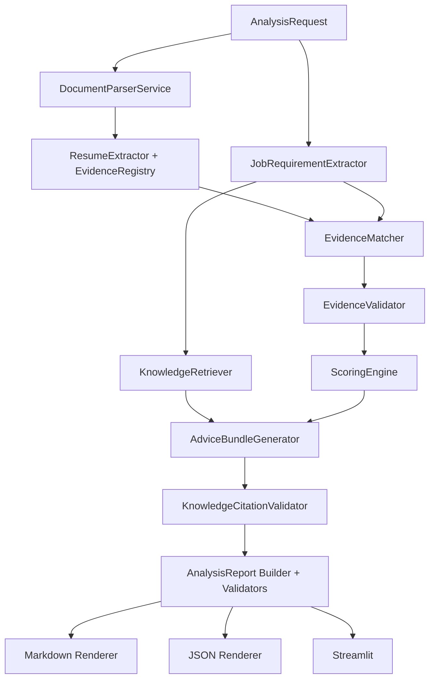
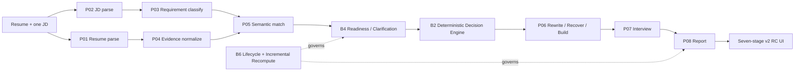

# JobFit Agent 当前架构

- 适用版本：`1.1.0`
- 文档日期：2026-08-10
- 目标读者：维护者、审阅者和后续开发者
- 历史设计：`docs/superpowers/specs/`与`docs/superpowers/plans/`

本文描述当前代码中的实际架构。历史Spec和Plan保留设计过程，不作为当前接口的替代品。

## 1. 核心原则

1. 简历证据是匹配判断的唯一候选人事实来源。
2. 评分、权重、封顶和推荐等级由确定性代码计算。
3. 大模型只承担结构化语义提取、证据相关性判断和受约束文本生成。
4. 岗位知识是独立参考层，不进入JD评分分母，不替代简历证据。
5. 任一关键校验失败时fail closed；知识不可用属于可恢复降级。
6. 普通测试必须离线、确定、无真实API费用。

## 2. 主工作流

`WorkflowOrchestrator.run()`按以下顺序执行：

1. 校验输入源；
2. 解析并标准化简历；
3. 提取`ResumeProfile`和`EvidenceRegistry`；
4. 提取`JobProfile`与原子化JD Requirements；
5. 检索可选岗位知识；
6. 以简历Evidence匹配JD Requirements；
7. 校验Evidence的文档、位置、引用和状态一致性；
8. 使用`ScoringEngine`计算分数与推荐等级；
9. 生成诊断、改写和面试建议；
10. 校验知识Citation；
11. 组装并校验`AnalysisReport`；
12. 从同一Report渲染Markdown和JSON。



## 3. 文档与证据层

### 3.1 输入

`AnalysisRequest`支持：

- 粘贴文本；
- TXT；
- DOCX；
- 带文本层PDF。

`DocumentParserService`按用户明确选择的来源解析，不自动混合文件和粘贴文本。图片型PDF没有OCR回退，解析失败后要求用户粘贴文本。

### 3.2 Evidence Registry

`ResumeExtractor`生成的事实必须引用`EvidenceRegistry`中的合法Evidence。Evidence包含：

- 文档ID；
- Segment ID；
- 原文Quote；
- 起止字符位置；
- 页码；
- Evidence类型与置信度。

`EvidenceValidator`复核引用是否来自当前简历、位置是否匹配、状态是否允许该类Evidence。知识Citation不能伪装成Resume Evidence。

## 4. JD要求与确定性评分

JD被提取为`JobRequirementCollection`。每条Requirement拥有稳定ID、类别、重要度、类型、mandatory和hard condition信息。

评分主链只消费：

- 当前JD Requirements；
- 当前简历的`RequirementMatch`。

固定状态映射：

```text
matched     = 1.0
partial     = 0.6
not_matched = 0.0
unknown     = 0.0
```

`ScoringEngine`使用`Decimal`，负责：

- 六维基础分；
- Requirement类型因子；
- 重要度因子；
- mandatory乘数；
- 缺失维度重归一化；
- implicit总权重上限；
- hard blocker与mandatory缺失封顶；
- Recommendation Level。

知识Requirement从不传入`ScoringEngine`。知识中的`is_common_hard_blocker`只作为岗位参考元数据展示，不能触发评分封顶。

## 5. 知识事实源与生命周期

### 5.1 版本控制Seed

事实源位于：

```text
data/knowledge/versions/<version>/
```

固定文件包括Manifest、Knowledge Base Version、Job Families、Role Profiles、Competency Dimensions、Role Requirements、Evidence Patterns、Sources、Chunks、Interview Questions和Source-role Links。

Seed Loader执行：

- 严格JSON Schema；
- 拒绝未知文件、未知字段和重复Key；
- 固定文件集合与大小限制；
- 稳定ID和引用完整性；
- Source checksum与Chunk hash；
- 路径、凭据、PII、私钥、HTML控制字符和Prompt Injection扫描；
- Canonical JSON SHA-256。

Canonical Hash不包含SQLite中的draft/published生命周期状态，但包含Seed实体的`review_status`；任何内容或审核状态变化都必须复算。

### 5.2 SQLite运行时副本

`KnowledgeDatabase`显式管理SQLite Engine和Session：

- Schema Revision：1；
- 10张领域表；
- Foreign Keys开启；
- Busy Timeout开启；
- 不自动创建或迁移未知数据库；
- Schema不匹配时fail closed；
- 运行时文件不进入Git。

`KnowledgeSeedImporter`允许创建或替换draft版本；published和retired版本不可变。`KnowledgeVersionPublisher`只有在全部发布门禁满足时才发布版本。

### 5.3 当前正式Seed状态

`2026.08.1`包含三个首批岗位方向。版本控制Seed仍为`draft`，182个可审核实体已由Publisher批准为`approved`，Canonical Hash为`346542eb0c405643a08ebc4bffdab9b5bce22a1b7227f5ad2b27f12e3d1ef7f4`。正式运行SQLite已通过影子数据库导入、publish、三岗位检索、Citation、Report、UI和原子切换验收；运行生命周期中的该版本为`published`，而版本控制Seed继续保持可审计的`draft/approved`状态。

## 6. Repository、搜索与Retriever

### 6.1 Repository

`SqliteKnowledgeRepository`只返回：

- published版本；
- approved且active的Role、Requirement、Pattern、Question和Source；
- 与选中版本和岗位范围一致的内容。

Repository不返回用户简历、JD、报告或任何评分对象。

### 6.2 搜索

`KnowledgeSearchIndex`运行时探测FTS5：

- 可用时构建可重建辅助索引；
- 不可用时使用确定性关键词回退；
- `auto`模式根据能力选择；
- FTS辅助表不属于Canonical Hash或Seed事实源。

关键词标准化包括NFKC、casefold、CJK bigram、查询长度和Token上限。排序使用版本化的Decimal纯函数与稳定Tie-break。

### 6.3 Retriever

`DefaultKnowledgeRetriever`使用已提取的Job Profile标题、摘要、关键词和Requirements进行岗位解析，不使用公司名或完整JD作为知识内容。

主要边界：

- 只选择一个清晰匹配的岗位；
- 跨Family接近或同Family精确并列时返回ambiguous；
- 不跨岗位混入Requirement或Citation；
- 限制Role、Requirement、Pattern、Question、Citation数量和字符预算；
- 版本、Citation或引用关系异常时fail closed。

## 7. 知识失败与安全回退

Composition Root根据配置构建三类Retriever：

1. `NoOpKnowledgeRetriever`：知识关闭；
2. `_UnavailableKnowledgeRetriever`：DB不存在、损坏、Schema不兼容或无指定published版本；
3. `_DatabaseBackedKnowledgeRetriever`：拥有数据库生命周期的有效Retriever。

知识异常不会改变已有JD提取、Evidence Match、Score或Recommendation。报告仍生成，但`ReportKnowledgeSection`显示`disabled`、`unavailable`、`no_match`或`ambiguous`状态。

不可恢复的Evidence、评分或Report一致性错误仍停止生成报告。

## 8. Advice与Citation

知识只进入Advice阶段的用户消息，并放在明确的`REFERENCE_KNOWLEDGE`边界内。系统消息不注入知识内容。

模型可以提出Citation Use草案，但本地Validator必须确认：

- Citation存在于本次Context；
- Citation属于同一知识版本；
- Citation属于当前选中岗位范围；
- Citation确实被提供给模型；
- 输出目标类型和索引存在；
- Citation不冒充简历Evidence；
- 使用关系不重复。

Citation失败时最多进行一次不含知识的Advice回退。回退不能改变评分结果。

## 9. Report 1.0与1.1

`AnalysisReport`兼容：

- Schema `1.0`：历史基础报告，加载时`knowledge=None`；
- Schema `1.1`：包含经过验证的`ReportKnowledgeSection`。

Knowledge Section只保存展示所需的紧凑元数据，不保存内部检索Context、数据库对象或完整来源正文。

Markdown、JSON和Streamlit都读取同一份已验证Report：

- Markdown包含独立“岗位知识参考”章节和免责声明；
- JSON使用`AnalysisReport.model_dump_json()`；
- UI不直接访问数据库重建知识内容。

## 10. 缓存与结果过期

工作流使用两级指纹：

1. 基础输入指纹：简历、JD、模式、Prompt版本等；
2. 最终分析指纹：基础指纹加知识状态、版本、Content Hash、检索策略、Prompt和Validator版本。

因此：

- 相同输入与相同知识身份可复用成功结果；
- Knowledge enabled/disabled、版本、Hash或策略变化会使旧结果过期；
- 解析和提取Artifact可以在知识变化时复用；
- 页面下载不会重复调用模型。

## 11. 配置

主要配置前缀为`JOBFIT_`。

LLM配置：

- `LLM_PROVIDER`；
- `LLM_MODEL`；
- `LLM_API_KEY`；
- `LLM_BASE_URL`。

知识配置：

- `KNOWLEDGE_ENABLED`；
- `KNOWLEDGE_VERSION`；
- `KNOWLEDGE_DB_PATH`；
- `KNOWLEDGE_SEARCH_MODE`；
- `KNOWLEDGE_REQUIREMENT_LIMIT`；
- `KNOWLEDGE_PROMPT_CHAR_LIMIT`；
- `KNOWLEDGE_RETRIEVAL_STRATEGY_VERSION`。

分析历史配置：

- `ANALYSIS_DB_PATH`：可选的绝对路径；留空时使用操作系统应用数据目录。路径解析和配置加载不执行I/O。

当前默认知识版本为`2026.08.1`。默认切换只在影子数据库、正式运行SQLite、有效配置、Streamlit和基础/增强一致性门禁全部通过后完成；受保护回滚可把有效运行版本恢复为`2026.07.1`。

## 12. 测试架构

测试分为：

- `tests/unit/`：模型、评分、Validator、报告和Composition Root；
- `tests/knowledge/`：Schema、Seed、SQLite、Repository、FTS、排序、Retriever和版本生命周期；
- `tests/integration/`：四类输入、完整Mock工作流、知识Advice、Report/UI和失败路径。

普通测试通过autouse fixture阻断`socket.connect`，并隔离本地`.env`。正式API测试必须显式使用`live_api` marker。

v1.1发布门禁重点包括：

- 四类输入在Knowledge enabled时完成同一Evidence工作流；
- Knowledge enabled与disabled的评分和推荐完全一致；
- common hard blocker不触发评分封顶；
- 损坏DB、未来Schema和无published版本安全回退；
- Prompt Injection Seed在导入前被拒绝；
- 项目版本一致；
- Git不跟踪SQLite、`.env`、上传文件或报告；
- 正式approved Seed可在临时SQLite中导入、幂等发布并通过三岗位检索隔离、Citation、Report和Streamlit UI门禁。

## 13. 隐私与存储边界

- 稳定入口 `app.py` 仍按原边界处理输入；v2 RC 将恢复历史所需的提取文本和区间写入独立分析库；
- 用户简历、JD、报告不写入公共知识库；
- v2 分析库不保存原始上传二进制、API Key、凭据、原始模型日志、Prompt、推理过程或本地绝对路径；
- v2 历史保留到用户显式删除；删除操作硬删除指定分析链或全部候选人分析数据，不删除岗位知识；
- 当前依赖宿主操作系统文件权限，不提供应用层字段加密、密钥管理、自动备份或云备份；
- 该边界仅适用于单用户、单实例本地或自托管 Streamlit，不是多租户云存储安全模型；
- 日志只记录允许的元数据；
- `.env`、运行时SQLite、WAL/SHM、缓存、报告和上传文件被忽略；
- 发布测试检查Git跟踪文件中不存在运行时数据库和私有输入目录。

## 14. 发布边界

发布准备分为独立阶段：

1. 回归测试、版本和文档；
2. Python 3.12干净环境与双路径验收；
3. Publisher人工批准与临时SQLite发布验证；
4. 生产运行数据库、默认版本和Release候选。

以下操作均不由应用自动执行：

- 修改已批准Seed的审核状态或业务内容；
- 未经Owner/Publisher授权发布、替换或回滚正式运行数据库；
- 未经阶段授权修改默认知识版本；
- 绕过备份、影子验证、原子切换或回滚门禁初始化正式运行数据库；
- 创建tag、GitHub Release、PR或push。

## 15. v2架构升级候选

v2以 `app_v2.py` 作为并行入口，保留 `app.py` 的现有行为。UI只调用 `V2AnalysisApplication`，不直接执行评分、Hard判定、Evidence定级或建议校验。

### 15.1 分析历史持久化

`AnalysisRepository`继续作为B6应用边界。`InMemoryAnalysisRepository`保留给隔离测试和显式注入；v2 RC的默认组装使用`SQLiteAnalysisRepository`。应用代码不直接执行SQL。

- 后端：SQLAlchemy 2.x同步Engine + SQLite，独立于Knowledge SQLite；
- 默认位置：Windows `%LOCALAPPDATA%/JobFitAgent/analysis.sqlite3`、macOS `~/Library/Application Support/JobFitAgent/analysis.sqlite3`、Linux `${XDG_DATA_HOME:-~/.local/share}/jobfit-agent/analysis.sqlite3`；
- Schema：`PRAGMA user_version = 1`，只初始化空库；未知更高版本和不兼容低版本Fail Closed，不引入Alembic；
- 并发：单实例短事务、`foreign_keys=ON`、合理`busy_timeout`和`secure_delete=ON`；不提供多写者或分布式锁；
- 完成记录：append-only、不可原地更新；父子Analysis Run保留重新分析链；
- 工作记录：只允许更新lifecycle、子状态、failure、`last_successful_stage`和逐步生成的终态字段，`analysis_ready`后的冻结输入快照不可变化；
- 内容：持久化`AnalysisRun`（含Snapshot、VersionManifest、AnalysisCore、JobFitReport、Action/Interview内容）、澄清记录，以及脱敏后的Resume/JD提取文本、segments和hash；
- 删除：显式删除一条分析链或全部分析数据；Knowledge SQLite完全不参与该事务；
- 恢复：重新创建Repository即可读取工作生命周期或完成报告，不重新调用LLM；
- 备份：本阶段不自动复制数据库，只保留未来扩展边界，避免额外敏感副本。



### 15.1 阶段职责

- P01-P05只产生结构化、可校验的简历事实、JD事实、Requirements、Evidence特征和语义关系；
- B4在B2之前处理最多3个能影响核心结论的澄清问题；
- B2继续作为分数、资格、Hard、Critical、置信度与推荐等级的唯一确定性权威；
- P06只生成分离的Rewrite、Recover、Build建议，P07只生成面试准备，P08只组装展示报告；
- B6保存不可变终态Analysis Run，并按依赖图规划最小重算。P07失败只重跑Interview与Report，P08失败只重跑Report。

### 15.2 七阶段UI与存储边界

v2页面顺序固定为：Home → Resume → JD → Clarification → Analyzing → Report → Update/Reanalyze。报告推荐结论优先展示，Hard条件独立展示，Build最多3项，底部只有3个主要动作。

v2 RC默认使用`SQLiteAnalysisRepository`，关闭会话或重启进程后历史仍可恢复。`InMemoryAnalysisRepository`仅用于测试和显式的进程内适配。当前不引入账号、云同步、多用户共享历史或新的Runtime依赖；保留期固定为“直到显式删除”，隐私删除可以删除单条历史链或全部本地分析数据。

### 15.3 Knowledge边界

v2核心判定不消费岗位知识。Knowledge OFF/ON必须得到完全相同的`AnalysisCore`。知识仅可按既有边界进入Build、Interview或Report参考，并必须保留Citation；不能成为候选人Evidence、不能改变评分分母，也不能把隐性岗位知识改写为JD明确要求。

### 15.4 Release Candidate门禁

B7-B9自动化门禁包括42个业务案例、12个分层Golden、6个关系Pair、三岗位高/中/低P01-P08全链路、Hard/Critical召回、Recommendation与Core Requirement指标、禁止断言、Prompt Injection、失败降级、局部重算、双入口AppTest/HTTP健康、Fresh Clone、branch coverage、静态检查与依赖一致性。

自动化只能验证建议的可追溯、非编造、结构、类型、来源边界、去重和Top3约束。建议质量的4/5或5/5评分仍必须由产品Owner人工完成；在此之前源码可以达到GitHub上传候选状态，但生产切换状态保持NO。
